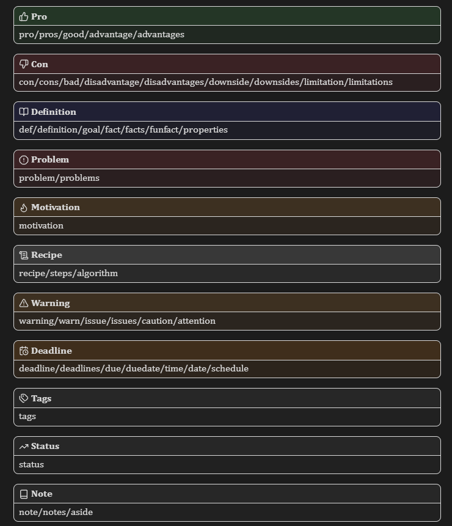
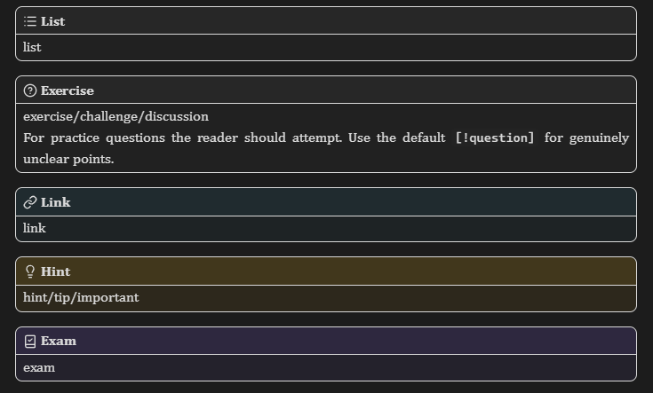

# obsidian-snippets

Personal collection of css snippets to customize the appearance of Obsidian notes.

## callouts

Change the look of every Obsidian callout as well as introduce new callout types. Based on [lkm-schulz](https://github.com/lkm-schulz/obsidian-snippets) callouts.

Design: Rounded corners, white borders and a separation between title and content of the callout.

Added/changed callouts:
- pro (pros/good/advantage/advantages)
- con (cons/bad/disadvantage/disadvantages/downside/downsides/limitation/limitations)
- def (definition/goal/fact/facts/funfact/properties)
- problem (problems)
- motivation
- recipe (steps/algorithm)
- warning (warn/issue/issues/caution/attention)
- deadline (deadlines/due/duedate/time/date/schedule)
- tags
- status
- note (notes/aside)
- list
- exercise (challenge/discussion)
- link
- hint (tip/important)
- exam

*Note:* warning, note and hint overwrite built-in Obsidian callouts, the rest are new types.

*To do:* Adjust this for a post-study life, where I hopefully don't need something like "exam" anymore.

## heading-font

1. Change the font of all headings to Arial (or default sans-serif if Arial is missing), since I like to have text body in serif but not the headings.

## heading-rules

Add simple wiki-style horizontal lines under every heading 1 (as can be seen in this readme if viewed on github).

## heading3-gap

Remove the gap between third headings (`###`) and lower to the text coming after it. Also works for Obsidian PDF exports

## no-emphasis-color

Make bold or italic text the same color as the regular one. This is only needed when using a theme that changes the emphasis color in the first place, like `Tokyo Night` (which is an amazing theme btw).

## pdf-title

Make the title stand out compared to a first heading for pdf exports. Why? Because I like using the filename as the title (sue me), and because I don't like that it is formatted as heading 1. 
